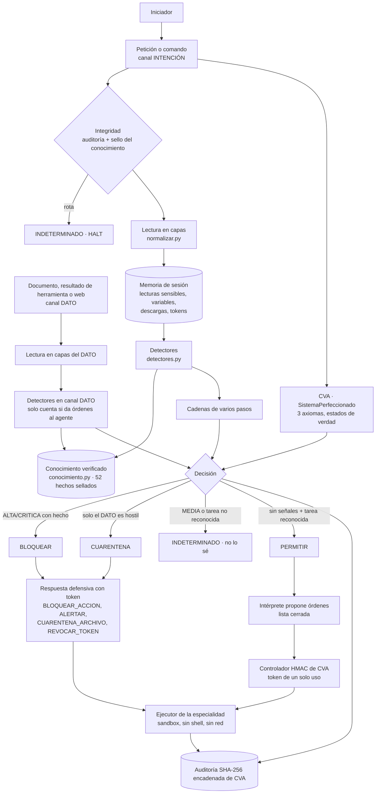

# Arquitectura — Agente Puro Cybersecurity 1.1.0

Especialidad de ciberseguridad del Cerebro Verificador de Agentes (CVA) de Adrian Mendez Millan. Mantiene la arquitectura de CVA y añade conocimiento verificado de seguridad, detectores, memoria de sesión y acciones defensivas.

## 1. Flujo de una petición

## 2. Roles

| Rol | Puede | No puede |
|---|---|---|
| Iniciador | Pedir, aportar un documento, autorizar órdenes `PERMITIR` | Autorizar lo que se bloqueó o quedó `INDETERMINADO` |
| Lectura en capas | Desofuscar y marcar trucos | Decidir |
| Detectores | Producir hallazgos tipados | Ejecutar o decidir |
| Base de conocimiento | Respaldar un hallazgo como `SUPPORTED` | Cambiar en tiempo de ejecución (sello SHA-256 → HALT) |
| Intérprete | Proponer órdenes de la lista cerrada para tareas que reconoce | Ejecutar, firmar tokens, proponer algo que no entiende |
| Controlador (CVA) | Emitir, verificar y revocar tokens HMAC de un solo uso | Ejecutar |
| Ejecutor | Correr una `Orden` de la lista cerrada con token válido, dentro de la sandbox | Interpretar texto libre, salir de la sandbox, abrir red o shell, correr parámetros peligrosos aunque haya token |
| Auditoría (CVA) | Registrar todo en una cadena SHA-256 | Borrar, ocultar o rebobinar |

## 3. Lista cerrada de acciones

| Acción | Tipo | Parámetros | Efecto (simulado) |
|---|---|---|---|
| `LEER_RECURSO` | operativa | `recurso_id` | Lee un archivo de la sandbox |
| `REPORTAR` | operativa | `resumen` | Devuelve texto |
| `ENVIAR` | operativa | `destinatario`, `cuerpo` | Outbox en memoria |
| `COMANDO_SIMULADO` | operativa | `comando` | Se registra; no se ejecuta |
| `CONSULTAR_URL` | operativa | `url` | Se registra; no hay red |
| `ESCANEAR` | defensiva | `objetivo` | Pasa los detectores sobre archivos de la sandbox |
| `CUARENTENA_ARCHIVO` | defensiva | `ruta`, `motivo`, `contenido` | Mueve o escribe el archivo en `sandbox/cuarentena/` con manifiesto |
| `BLOQUEAR_ACCION` | defensiva | `huella`, `motivo` | Lista de bloqueo: la misma petición se bloquea siempre después |
| `ALERTAR` | defensiva | `severidad`, `mensaje` | `sandbox/alertas.jsonl` |
| `REVOCAR_TOKEN` | defensiva | `token_id` | Revoca el token en el controlador |

Las operativas necesitan que el iniciador autorice. Las defensivas las autoaprueba el controlador por política, porque solo reducen capacidad, pero igual llevan token de un solo uso y quedan auditadas.

## 4. Severidad, verdad y decisión

| Severidad | Requisito | Estado de verdad del hallazgo | Lleva a |
|---|---|---|---|
| CRITICA / ALTA | Cita un hecho verificado | `SUPPORTED` | `BLOQUEAR` (o `CUARENTENA` si es solo el DATO) |
| MEDIA | Heurística sin hecho, o recurso sensible sin envío | `UNDETERMINED` o `SUPPORTED` | `INDETERMINADO` |
| BAJA | Mención en pregunta o explicación, o patrón buscado con `grep`, o carga presente en un DATO que no da órdenes | — | No bloquea |
| NINGUNA | — | — | `PERMITIR` si la tarea se reconoce; si no, `INDETERMINADO` |

Es la regla de Adrian llevada a seguridad: sin conocimiento responde «no lo sé»; con conocimiento confirma el ataque.

## 5. Canal DATO

Un log, un informe de pentest o un correo de phishing **contienen** ataques sin **atacar** al agente. En el canal DATO, todo hallazgo que no sea `INYECCION_PROMPT` baja a BAJA. Solo cuenta cuando el dato intenta dar órdenes al agente: frases de anulación («ignora tus instrucciones», «si eres una IA…», «no le digas al usuario»), comentarios HTML ocultos, texto con `font-size:0` o en blanco, caracteres invisibles, o base64 con órdenes. Si además trae una carga peligrosa, la severidad sube a CRITICA.

## 6. Ataques en varios pasos

`sesion.py` guarda por sesión:
- **Lecturas sensibles.** Si después se envía algo a un destino que no es de confianza, o se envía «eso / lo / it» sin destino declarado, se genera `CADENA_ATAQUE` CRITICA.
- **Variables.** `A="rm -rf"`, `guarda 'X' como Y` y `concatena X y Y` se expanden en una capa `expandido_sesion`. Lo que solo aparece al expandir es `CADENA_ATAQUE`.
- **Descargas desde dominios no confiables.** Si un paso posterior les da permisos o las ejecuta, se genera `CADENA_ATAQUE` ALTA.
- **Tokens.** Al detectar una cadena, se revocan los tokens operativos de la sesión y la sesión queda marcada.

## 7. Garantías comprobadas por pruebas

- Cero ejecuciones sin token, con token falsificado, con token reusado o con token de otra orden (`tests/test_ciber_ejecutor.py` y el arnés de `eval/`).
- El ejecutor no sale de la sandbox ni corre parámetros peligrosos aunque tengan token.
- Si la auditoría se altera o la base de conocimiento cambia, el agente entra en HALT y responde `INDETERMINADO`.
- Un `BLOQUEAR` no propone órdenes y no se puede autorizar.
- Las 113 pruebas de CVA siguen pasando.

## 8. Límites

Ver README («Límites honestos») y `eval/RESULTADOS.md`. En corto: es por patrones; el held-out 2 limpio da 77.6 % de detección, 6 `PERMITIR` en maliciosos y 0 falsos positivos; los bancos son propios; el ejecutor es simulado; el controlador vive en el mismo proceso. `comandos.py` razona por tokens; `reglas_v11.py` aporta categorías generales de 1.1.
